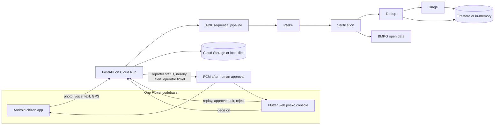

# Architecture

TIPO (TIten POsko) is an operator-side triage copilot. Citizens already have ways to report a flood. The missing layer is the posko: reading mixed reports, dropping duplicates and old photos, and drafting the situation report. A person still approves every public alert.

## Agents

The live graph is a Google ADK `SequentialAgent` named `tipo_triage_pipeline` with four `LlmAgent`s:

| Agent | Default model | Job |
| --- | --- | --- |
| Intake | `gemini-3.8-flash` | Hazard, place, severity, people, vulnerable groups, needs, language, English translation. Voice notes name `gemini-3.5-transcribe`. |
| Verification | `gemini-3.8-flash` | Credibility 0–100 with reasons. Tools: BMKG forecast, autogempa, nowcast RSS. Missing EXIF is neutral. |
| Dedup | `gemini-3.5-flash-lite` | Merge reports of one incident. Embeddings use `gemini-embedding-2-preview` when live. A score under 40 cannot join a confirmed incident. |
| Triage | `gemini-3.8-flash` | Priority, logistics, nearest seeded team, BNPB-style sitrep draft. It does not send alerts. |

Model ids were checked against [Gemini models](https://ai.google.dev/gemini-api/docs/models) on 10 Oct 2026 and are overridden with `TIPO_MODEL_*`.

ADK 2.11 marks `SequentialAgent` as deprecated in favor of `Workflow`. This prototype keeps `SequentialAgent` because that is the sequential multi-agent shape the product needs, and it still runs. `Workflow` cannot yet be used as an `LlmAgent` sub-agent.

## Modes

- **Mock.** No API key. Each agent is a deterministic function with the same JSON contract. Replay of the Dayeuhkolot drill always clusters the same way. Token embeddings stand in for Gemini embeddings and are labeled as such.
- **Live.** With `GOOGLE_API_KEY` or Vertex AI env vars, the API runs the ADK pipeline and may replace the English translation, summary, and a verification note. If the call fails or returns no JSON, the deterministic result is kept and the trace says `live_fallback`. Clustering stays deterministic so a replay cannot fork.

## Human gate

`operator_ticket` can be created when a new high or critical ticket opens. That message stays inside the posko. `reporter_status` and `nearby_alert` are created only in `POST /api/incidents/{id}/decision` when a human approves. Rejecting a report notifies the reporter and does not fan out a nearby alert, even if `send_alert` is true.

## Data

| Store | Mock | Live / deployed |
| --- | --- | --- |
| Reports, incidents, notifications | Process memory | Firestore if `TIPO_STORE=firestore` |
| Photos and voice | `backend/data/uploads` and `scenario/media` | Cloud Storage if `TIPO_GCS_BUCKET` is set |
| Push | In-app inbox polled by the app | FCM if `TIPO_FCM=true` and a service account is set |

Firestore security rules deny all client access. The API uses the Admin SDK.

## BMKG

Tools call:

- `https://api.bmkg.go.id/publik/prakiraan-cuaca?adm4=`
- `https://data.bmkg.go.id/DataMKG/TEWS/autogempa.json`
- `https://data.bmkg.go.id/DataMKG/TEWS/gempaterkini.json`
- `https://www.bmkg.go.id/alerts/nowcast/id/rss.xml`

The replay cites a recorded heavy-rain snapshot. On 10 Oct 2026 the live forecast for Sukarasa, Kota Bandung (`32.73.01.1001`) was mostly cloudy with 0 mm of rain, so a live reading would have marked the drill as weakly supported. Desa Dayeuhkolot itself is adm4 `32.04.12.2002`, confirmed against BMKG during the build. The dashboard can still request `/api/bmkg?live=true`.
